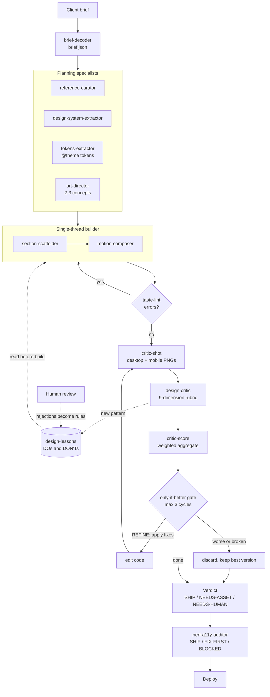

<h1 align="center">Hertwave OS</h1>

  <strong>An internal site factory: Claude Code agents that build client websites, then judge and fix their own output.</strong>

  Built for the Hertwave studio, so a one-person team can ship custom marketing sites without each one starting from zero.

  <a href="https://hertwave.com"><strong>See a site it built →</strong></a>

  

hertwave.com, built and critiqued through the factory. The factory itself has no UI: it is agents, scripts and a lessons file.

---

## What it is

Hertwave OS is the toolkit the studio uses to build every client site. It has three parts:

- **Agents.** Claude Code subagents, each with one job: decode the brief, pick references, extract design tokens, scaffold sections, add motion, audit performance and accessibility, and critique the rendered page.
- **Check scripts.** Plain Node.js scripts that take deterministic screenshots, lint the source for "AI-generated" tells, compute the critic's score, and measure LCP.
- **Memory.** A design-lessons file of DOs and DON'Ts. Builders read it before generating. The critic writes to it after judging. Rejections from the human reviewer become permanent rules.

Every site project points its `taste`, `shot` and `score` scripts at the factory, so one copy of the tooling serves all of them.

## The problem

Language models converge on the same website: centered hero, purple accent, three icon cards, Inter everywhere. A single prompt that goes from text to code produces that median every time.

Two cheap fixes do not work. Asking the model to "be more creative" just moves the median. Letting a vision model loop freely on its own output makes it drift and sometimes get worse. The studio also kept relearning the same lessons on every new client, because nothing carried knowledge from one project to the next.

## How it works

1. **Brief.** A free-text brief in Portuguese becomes structured JSON: industry, tier, sections, and at most three "hero moments" per site.
2. **References and tokens.** Read-only agents pick a north-star reference, pull a design system from a URL when there is one, and write Tailwind v4 `@theme` tokens in OKLCH.
3. **Build.** One builder thread scaffolds each section, then adds motion at marked points. Builders load the lessons file first.
4. **Lint.** `taste-lint` runs on the source and the prerendered HTML. Any error sends the build back before a single vision call is spent.
5. **Critique.** Playwright takes fixed-viewport screenshots. The critic scores them on a 9-dimension rubric and proposes concrete fixes.
6. **Fix loop.** Fixes are applied, the page is shot and scored again, and the revision is kept only if the weighted score went up. Three cycles at most.
7. **Verdict and learning.** The critic returns SHIP, NEEDS-ASSET or NEEDS-HUMAN and appends any new pattern to the lessons file. A final perf and accessibility audit runs before deploy.

## Architecture

- **Agents** are Markdown definitions with a tool allowlist and a model. Builders and specialists run on Sonnet; the design critic runs on Opus because it has to read screenshots.
- **Artifacts pass by file, not by context.** Each agent writes to a git-ignored `.hertwave/` folder (`brief.json`, references, audits) that the next one reads.
- **`critic-shot.mjs`** renders the page in headless Chromium at 1440×900 and 390×844, with reduced motion on and a settle wait, and saves full-page and above-the-fold captures. Same input, same pixels, so scores are comparable across cycles.
- **`critic-score.mjs`** does the rubric math: weighted average (weights sum to 19), minimum dimension, verdict thresholds, and the accept or discard decision.
- **`taste-lint.mjs`** is static analysis with 12 rules in two halves: CSS, motion and accessibility, plus copy rules that read what the visitor actually sees.
- **`lcp-probe.mjs`** and **`optimize-hero.mjs`** keep visual assets from stealing the Largest Contentful Paint from the server-rendered headline.

## Engineering decisions

**1. One builder thread, parallel only for read-only work.** An early version used a single agent that tried to generate the whole site, and its output was huge and hard to debug. The fix was narrow agents, but the code-writing ones run in sequence on one thread. Only research, reference picking and token extraction run in parallel, because they have no cross-dependencies. Two builders working in parallel make choices the other cannot see, and the styles drift apart. Cost: a build takes longer than a swarm would, and the pipeline depends on strict output formats between agents.

**2. A rubric and a gate, not a free-running vision loop.** The critic never gives one overall grade. It scores 9 named dimensions (frame, composition, point of view, hierarchy, density, color, type, micro-craft, a11y/perf), each with anchors for what a 5 and a 9 look like, and every fix must point at something visible in the screenshot. The model only assigns scores; a plain script computes the aggregate and the verdict, so that part is reproducible. A revision is accepted only if the aggregate rises and the page still renders. A blank page or failed build scores zero. This follows published work on critic-refiner loops ([ReLook](https://arxiv.org/abs/2510.11498)), where an unguarded loop gets worse or games the critic. Cost: each cycle costs a full screenshot round trip, so it stops at three.

**3. Cheap deterministic checks before the expensive model.** `taste-lint` catches the binary tells (default purple accent, `transition: all`, removed focus outlines without a replacement, inputs under 16px, missing reduced-motion guard, flat low-opacity shadows) for free, so the vision call only judges what a regex cannot. The copy half also scans the prerendered HTML, because the source alone has blind spots. Cost: static rules give false positives. The reduced-motion rule first flagged every CSS module even when one global guard covered them all; it now pre-scans for that guard.

**4. Memory as a reviewed lessons file.** Each lesson records the rule, the evidence, how to apply it and where it came from. A pattern becomes a strong DON'T only after it shows up in two builds, so one odd case does not become doctrine. The human reviewer outranks the critic: when a site passed every automated gate and was still rejected for five specific reasons, all five became permanent rules. Cost: the file keeps growing and needs dedup and pruning, and it holds Portuguese prose rather than machine-checkable rules.

**5. Knowledge base, not a boilerplate template.** The first plan was a Next.js starter cloned for every client. The first real client site ended up so custom that reusing the skeleton would have meant refactoring it, and the template kept carrying settings the production site had already proved wrong (smooth-scroll library on by default, 3D canvas in the main bundle). In May 2026 the template was archived. Each site now starts from an empty project, and the reusable value lives in agent rules, decision records and the lessons file. Cost: day one of each project is slower.

## Results

- **2026-06-01, does the memory help?** Same section, same model, same spec; the only variable was reading the lessons file. Without it the first draft scored 5.11; with it, 6.95. After two gate-accepted cycles it closed at 7.74.
- **2026-06-01, new vertical.** An e-commerce build the lessons had never seen (it later became [Oktal](https://oktal.com.br)) started at 7.58 (home) and 7.42 (product page). Both reached 8.05 and SHIP in two cycles.
- **2026-06-01, gate test.** A deliberately bad revision (centered, card removed, four-line headline) scored 4.53 against a 7.16 baseline and was discarded.
- **2026-06-01, asset vs CSS.** The critic flagged NEEDS-ASSET when composition plateaued. Adding a generated hero image raised the aggregate from 7.16 to 7.95 and point of view from 5 to 7, with the headline still the LCP element.
- **2026-07-28, copy lint.** On hertwave.com the copy rules found 15 defects (108 occurrences) before the pass and 0 after, with no false positives in code comments or shaders.
- **As of 2026-08-14,** the lessons file had numbered entries up to DON'T #84 and DO #107.

Live sites built with the factory's agents, critic or check scripts:

| Site | What it is |
|---|---|
| [hertwave.com](https://hertwave.com) | The studio's own site, in Portuguese and English |
| [nowmarketing.com.br](https://nowmarketing.com.br) | Marketing agency site with a 3D opening; first real client through the pipeline |
| [nowimoveis.com](https://nowimoveis.com) | Real-estate video site where each YouTube tour becomes a page in chapters |
| [oktal.com.br](https://oktal.com.br) | Tech gadget store |
| [jimmyk.com.br](https://www.jimmyk.com.br) | Barbershop site |

## Stack

- **Agents:** Claude Code subagents (Markdown definitions), Sonnet for builders, Opus for the vision critic
- **Check scripts:** Node.js ES modules, Playwright (Chromium), sharp for AVIF and WebP
- **Sites produced:** Next.js 16, React 19, TypeScript, Tailwind CSS v4 with `@theme` tokens in OKLCH
- **Motion:** GSAP with ScrollTrigger, Framer Motion, React Three Fiber (dynamically imported, paused off-screen)
- **Deploy:** Vercel

## My role

Solo project. I designed the factory and its pipeline, wrote the agent definitions, the rubric, the gate and the lint rules, and built the scripts with Claude Code as my coding tool. I made the architecture calls above, including archiving my own template once a real client proved it wrong. I am also the human reviewer at the end of the loop: my rejections on real client work are where most of the permanent rules came from.

---

> Source code is private. This repository is a case study.

<a href="https://github.com/AllanHert">github.com/AllanHert</a>

